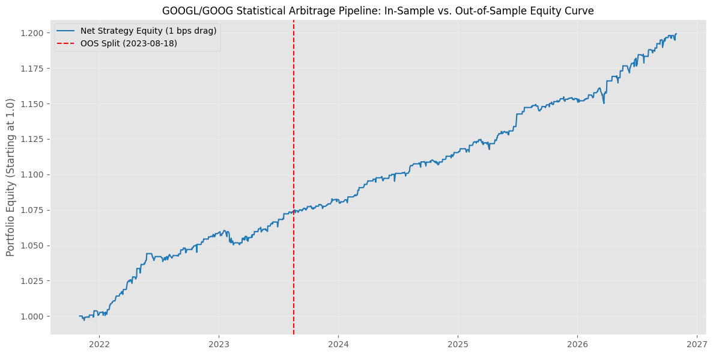
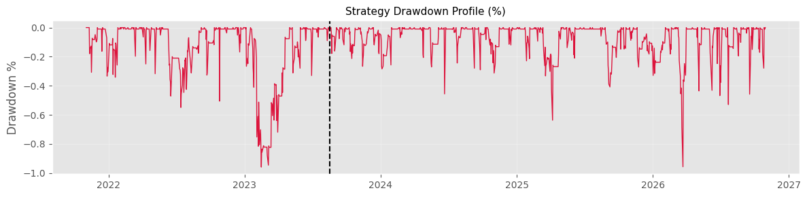

# Vectorized Cointegration & Statistical Arbitrage Engine

**Date:** 11 August 2026

---

## 📌 Overview

This project investigates a co-integrated pair of stocks with a goal to create a trading strategy based on the linear relationship. The final pair consists of Class A voting shares (GOOGL) and non-voting Class C shares (GOOG), which creates a dual-class co-integrated pair which we can profit from. We then calculate the average mean-reversion and the look-back window via the discrete Ornstein-Uhlenbeck Process. The strategy consists of going long when the Z-score is below -1.25 because that means that the Class A shares are underpriced relative to its non-voting counterpart, and short otherwise. 
---

## Results: We assume 0.0001$ of transaction costs per trade. Lastly, compute the metrics. Where the Sharpe Ratio is the average of the return differentials divided by the standard deviation. Our results show a modest decay of the Sharpe Ratio when we apply the algorithms OOS. Importantly, our annualised volatility has remained largely the same, which is remarkable. It is stable and low. Consequently, our Sharpe Ratio has retained 97.7% of its in-sample efficiency. With a tightly contained loss of ~1$ which means that strategy is successful. To showcase this, I have prepared two graphs represent the dual equity curve plot and the maximum drawdown chart.

## Equity Curve

## Maximum Drawdown

---

## 📬 Contact

If you have questions or suggestions regarding the methodology or execution, feel free to reach out (no spam please):

* **Author:** [Mikhail Semenov]
* **Email:** [ms624@st-andrews.ac.uk]
